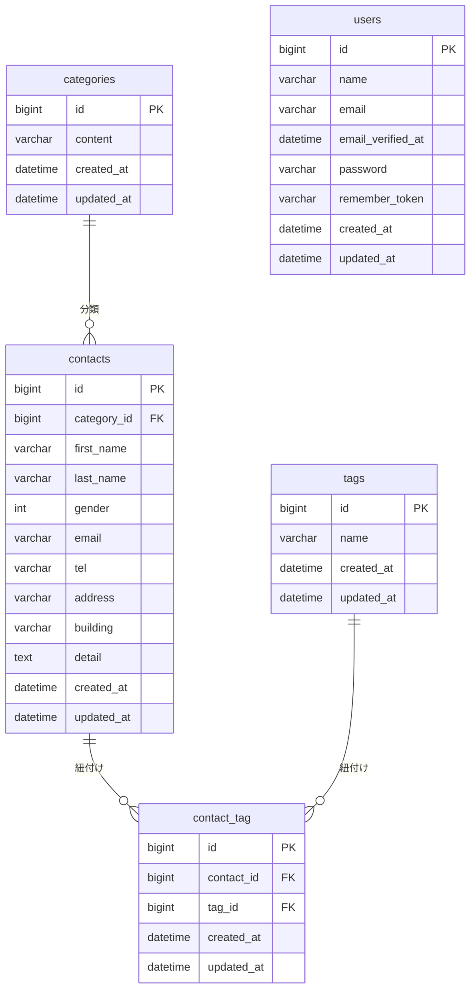

# お問い合わせフォームアプリ

## 概要
COACHTECHの確認テストとして、Laravelを使用して開発したお問い合わせ管理アプリケーションです。

## 主な機能
- お問い合わせ入力・確認・送信完了
- 入力内容のバリデーション
- 管理者ログイン・ログアウト
- お問い合わせ一覧・検索・詳細表示・削除
- CSVエクスポート
- カテゴリ・タグによる管理
- REST APIによるお問い合わせの取得・登録・更新・削除
- Seederによる初期データ登録

## 使用技術
- PHP / Laravel
- MySQL
- Docker / Laravel Sail
- Blade
- Tailwind CSS
- Alpine.js

## テスト
LaravelのFeatureテストを実装しています。

実行コマンド：

`./vendor/bin/sail artisan test`

確認結果：10テスト成功、28アサーション成功（非推奨警告2件）。

## 備考
環境設定ファイル `.env` はセキュリティ保護のためGitHubには含めていません。

## 環境構築手順

### 1. リポジトリの取得

以下のコマンドでGitHubからプロジェクトを取得します。

```bash
git clone https://github.com/himiko4991/contact-form-app.git
cd contact-form-app
```

### 2. 必要なパッケージのインストール

Laravelの動作に必要なPHPのパッケージをインストールします。

```bash
docker run --rm -v "$(pwd):/app" -w /app laravelsail/php85-composer:latest composer install --ignore-platform-reqs``
```

### 3. 環境設定ファイルの準備

`.env.example` をコピーして `.env` を作成します。

```bash
cp .env.example .env
```

作成した `.env` のデータベース接続設定を、以下のように変更します。

```env
DB_CONNECTION=mysql
DB_HOST=mysql
DB_PORT=3306
DB_DATABASE=laravel
DB_USERNAME=sail
DB_PASSWORD=password
```

### 4. Laravel Sailの起動

Docker Desktopを起動してから、以下のコマンドを実行します。

```bash
./vendor/bin/sail up -d
```

### 5. アプリケーションキーの生成

以下のコマンドでLaravelの暗号化キーを生成します。

```bash
./vendor/bin/sail artisan key:generate
```

### 6. データベースの準備

マイグレーションを実行し、テーブルの作成と初期データの登録を行います。

```bash
./vendor/bin/sail artisan migrate --seed
```

### 7. フロントエンドの準備

JavaScriptとCSSに必要なパッケージをインストールし、ビルドします。

```bash
./vendor/bin/sail npm install
./vendor/bin/sail npm run build
```

### 8. アプリへのアクセス

環境構築が完了したら、ブラウザで以下のURLにアクセスします。

お問い合わせフォーム：
http://localhost

管理画面：
http://localhost/admin

### APIエンドポイント一覧

お問い合わせ情報を操作するREST APIを実装しています。

| メソッド | エンドポイント | 機能 |
|---|---|---|
| GET | `/api/v1/contacts` | お問い合わせ一覧取得 |
| GET | `/api/v1/contacts/{contact}` | お問い合わせ詳細取得 |
| POST | `/api/v1/contacts` | お問い合わせ新規登録 |
| PUT | `/api/v1/contacts/{id}` | お問い合わせ更新 |
| DELETE | `/api/v1/contacts/{id}` | お問い合わせ削除 |

APIの動作確認にはPostmanを使用しました。

## ER図

